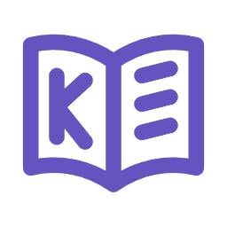
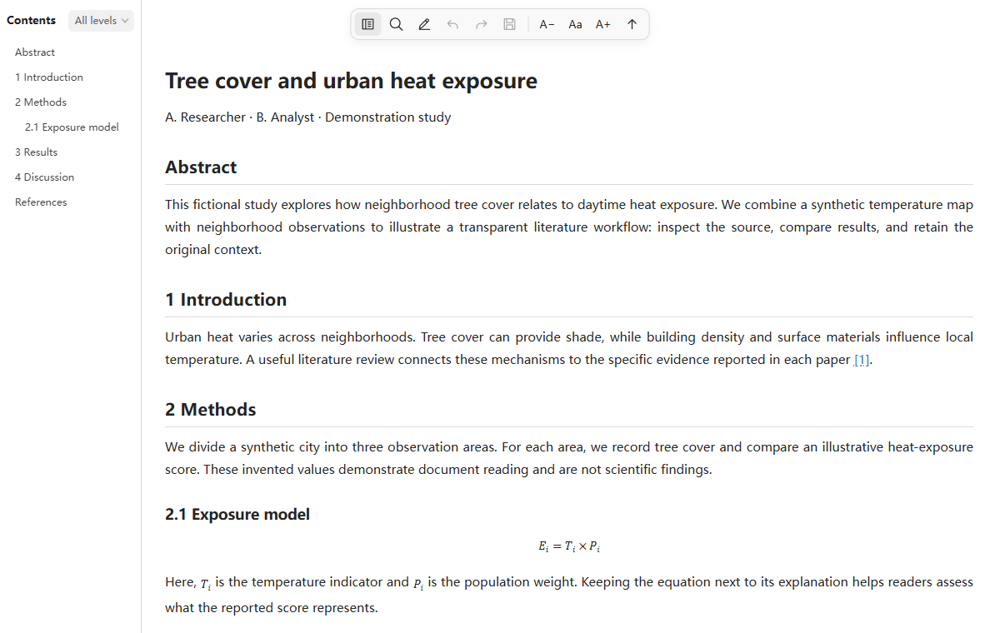
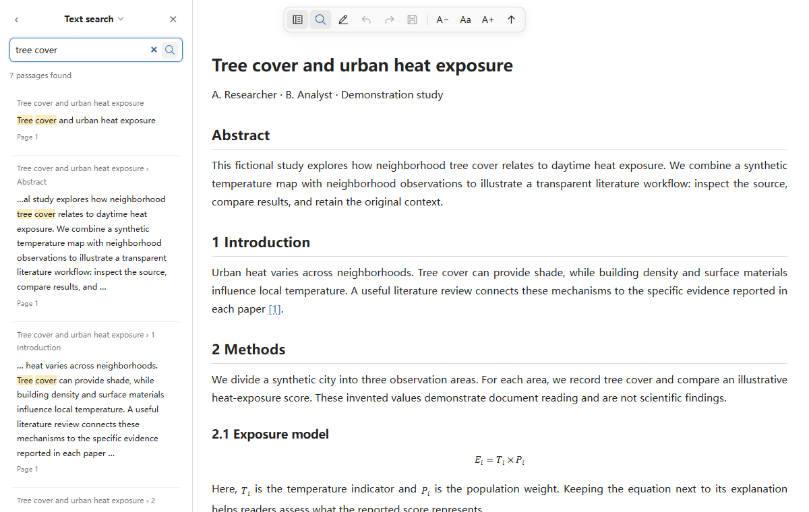
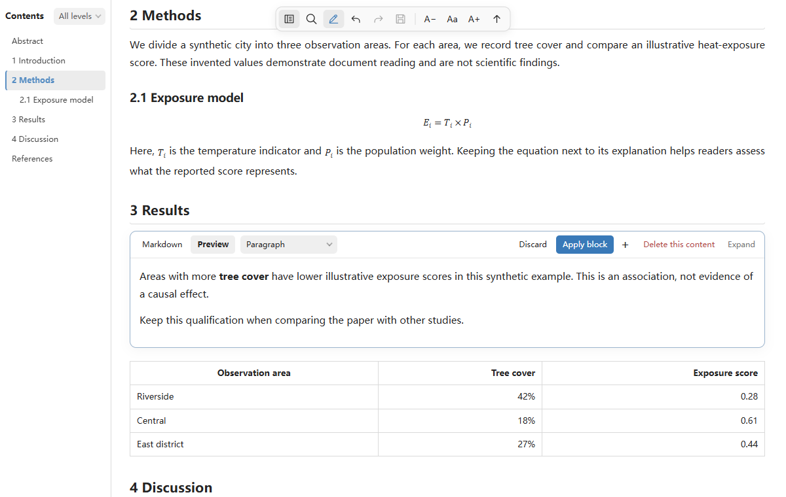

# Zotero Knowledge MCP

**Read, search and connect your Zotero papers to AI research tools.**

Zotero Knowledge MCP turns selected PDF attachments into a local knowledge
library. Extract their text, read and correct it beside the original PDF, find
relevant passages across your papers, and give compatible AI clients controlled
access through the Model Context Protocol (MCP).

Your papers stay organized in Zotero. The plugin adds processed text, knowledge
folders, retrieval and AI access to that workflow. It works with MCP clients such
as AI-Scientist and Codex; you can also use its reading and search tools directly.

**[Download the preview XPI](https://github.com/lianghx123/zoteroknowledgemcp/releases/download/v0.2.0-preview.1/zotero-knowledge-mcp.xpi)**
· **[User guide](https://lianghx123.github.io/zoteroknowledgemcp/)**
· [Release notes](https://github.com/lianghx123/zoteroknowledgemcp/releases/tag/v0.2.0-preview.1)
· [Report a problem](https://github.com/lianghx123/zoteroknowledgemcp/issues)

User guides: [English](https://lianghx123.github.io/zoteroknowledgemcp/)
· [简体中文](https://lianghx123.github.io/zoteroknowledgemcp/zh-CN/)
· [繁體中文](https://lianghx123.github.io/zoteroknowledgemcp/zh-TW/)
· [Deutsch](https://lianghx123.github.io/zoteroknowledgemcp/de/)
· [Français](https://lianghx123.github.io/zoteroknowledgemcp/fr-FR/)
· [Español](https://lianghx123.github.io/zoteroknowledgemcp/es-ES/)
· [日本語](https://lianghx123.github.io/zoteroknowledgemcp/ja-JP/)

> **Preview: 0.2.0-preview.1 · Zotero 10.0.x**
> Native development checks have used Windows with Zotero 10.0.6–10.0.8.
> Equivalent macOS/Linux acceptance is pending. Source, release installers and
> checksums are public; downloads do not require a GitHub account.

## What you can do

| When you want to… | The plugin helps you… |
| --- | --- |
| Bring a set of papers into a research workflow | Add selected items to knowledge libraries and folders, or continuously synchronize a Zotero collection. |
| Read a dense PDF more comfortably | Extract structured text with headings, formulas, tables and images, then open a Markdown companion in Zotero's PDF reader. |
| Find the passage you remember | Search by text or meaning, combine both, and inspect passages linked to their source documents. |
| Correct an extraction mistake | Edit Markdown blocks, preview changes, undo/redo and explicitly save the corrected document. |
| Let an AI client work with your literature | Authorize it to discover papers, search and read structured content using library-scoped MCP tokens. |
| Keep access under your control | Choose admitted papers, configured services, authorized libraries and separate read/write permissions. |

## See it in action

The demonstrations below use the current plugin's actual reader components with
an original fictional paper in a browser fixture. They show component behavior,
not a complete native Zotero window, provider-quality evaluation or real research
findings. No private literature is included. [Screenshot details](docs/assets/showcase/README.md).

### Read structured text with a navigable outline

Open a processed PDF and click **M** to show its Markdown companion. Follow the
heading outline, read formulas and tables, inspect recognized citations and
adjust text size while keeping the PDF available in the native reader.



[Explore the reader](https://lianghx123.github.io/zoteroknowledgemcp/reader/)

### Find passages inside a paper or across your knowledge libraries

Search the current document from its companion sidebar, or search a knowledge
library from Zotero's search dropdown. Text search works with published content;
semantic, enhanced semantic and fusion modes use configured model services.
Open a result to inspect its passage and source context.



[Choose a search mode](https://lianghx123.github.io/zoteroknowledgemcp/search/)

### Correct extracted content before using it downstream

Edit a block's Markdown or formula source and switch to preview. Supported blocks
also allow type changes, insertion and confirmed deletion. **Apply block** updates
the working preview; **Save document** publishes the corrections for subsequent
reading and retrieval. Unsaved edits are lost when the reader closes or Zotero
restarts.



[Learn how editing and saving work](https://lianghx123.github.io/zoteroknowledgemcp/reader/#correct-a-block)

## Your first paper

1. **Install the XPI.** In Zotero, open **Tools → Plugins → gear menu → Install
   Plugin From File…** and select `zotero-knowledge-mcp.xpi`. Restart if requested.
   Download the XPI, rather than GitHub's source ZIP or tar archive.
2. **Configure a parser.** Open **Zotero Settings → Knowledge MCP → Document
   parsing**. Select **PaddleOCR (PaddleOCR VL-1.6)** or **MinerU (VLM)**, enter the
   matching credentials, enable parsing and save.
3. **Add one local PDF.** Right-click its Zotero item, choose **Add to Knowledge
   Base**, and select a destination. Open **Import Tasks** to follow extraction
   and any enabled semantic-indexing work.
4. **Read and search.** Open the PDF, click **M**, and try the outline and text
   search. For semantic retrieval, configure and enable **Models and retrieval**
   and wait for the matching content to be indexed.
5. **Connect an AI client when needed.** Enable local MCP, issue a token for
   specific knowledge libraries and configure the client with the address shown
   in settings. Search/read permissions and annotation/summary writes are separate.

End users do **not** need Node.js, npm, Python or an external helper server.
Parser/model services can require provider accounts, API credentials and paid quota.
Parsing, model services and MCP start disabled on a new installation.

[Full first-document walkthrough](https://lianghx123.github.io/zoteroknowledgemcp/quick-start/)
· [Service configuration](https://lianghx123.github.io/zoteroknowledgemcp/configuration/)
· [Installation and SHA-256 verification](https://lianghx123.github.io/zoteroknowledgemcp/installation/)

## Use your knowledge libraries from an AI client

The local MCP server exposes 16 tools for literature discovery, passage search,
structured document/section/block reading, references and permitted
annotation/summary writes. A client can first locate relevant papers, then read
selected sections with their source identifiers instead of requiring you to
paste whole documents into a chat.

The default address is `http://127.0.0.1:23126/mcp/knowledge`. It uses authenticated
Streamable HTTP with SSE responses and accepts same-computer connections while
Zotero is running. It does not provide a built-in AI chat or public remote access.

For Codex, make your token available as `ZOTERO_KNOWLEDGE_MCP_TOKEN` in the
client's launch environment, then add the server:

```sh
codex mcp add zotero-knowledge --url http://127.0.0.1:23126/mcp/knowledge --bearer-token-env-var ZOTERO_KNOWLEDGE_MCP_TOKEN
```

Use the actual address from settings if you changed the port. The token secret
is shown once; grant only the libraries and permissions the client needs.

[MCP setup and token management](https://lianghx123.github.io/zoteroknowledgemcp/mcp/)

## Data, privacy and updates

- **Originals stay in Zotero.** Knowledge organization and extracted content are
  separate from native bibliographic records and attachment files.
- **Derived data is local.** The knowledge database, extracted assets and indexes
  reside under `knowledgemcp/` in Zotero's data directory.
- **Configured services receive data.** Parsing uploads selected PDFs; embeddings
  send text or queries; optional reranking can send candidate passages. An
  authorized AI client may send retrieved content to its own model provider.
- **Protect credentials and backups.** Parser keys currently reside in plaintext
  in local `parsing.json`; model keys use Gecko Login Manager. Close Zotero and
  back up its complete data directory before preview upgrades. Upgrade snapshots
  do not replace a complete external backup.
- **Previews update manually.** The automatic channel accepts verified stable
  releases only. With no stable release, the feed remains empty. Installing an older
  XPI does not downgrade a newer database schema.

[Data and privacy](https://lianghx123.github.io/zoteroknowledgemcp/privacy/)
· [Troubleshooting](https://lianghx123.github.io/zoteroknowledgemcp/troubleshooting/)

## Preview status

The local knowledge, parsing, retrieval, reader/editing and MCP workflows are
implemented. This is still a development preview: approximately 1,000-paper
end-to-end acceptance, independently assessed retrieval quality, complete
backup/restore tooling and broader cross-platform acceptance remain pending.
Public HTTPS/relay MCP access, plugin cloud synchronization and direct import of
arbitrary parser results are not available.

[Release notes](docs/releases/0.2.0-preview.1.md)
· [Compatibility and support](https://lianghx123.github.io/zoteroknowledgemcp/support/)
· [Detailed delivery status](docs/development/project-status.md)

## For contributors

Use **Node.js 22.23.1** and an isolated Zotero 10 development profile. Start with
[AGENTS.md](AGENTS.md) and the [development guide](docs/development/getting-started.md)
for setup, hot reload, validation commands and data-safety requirements.

[Architecture](docs/development/src-architecture.md)
· [Implementation reference](docs/development/implementation-overview.md)
· [Release and stable-update workflow](docs/development/releases.md)
· [Documentation publishing](docs/development/documentation.md)

## Credits and license

Created and maintained by [lianghx123](https://github.com/lianghx123).
Project code and documentation use the [MIT license](LICENSE). Bundled
third-party components retain their own licenses and notices.
