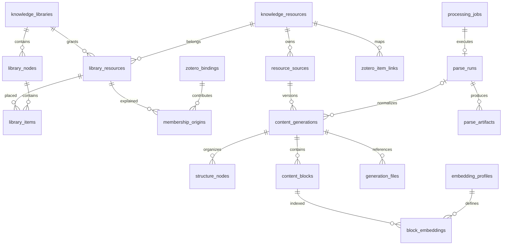

# Local Database Design

This reference describes the implemented plugin-owned schema and storage boundaries. See the [delivery plan](migration-plan.md#accepted-five-step-execution-order) for the capability map.

This is the reviewed local schema baseline, now implemented through sixteen statically bundled Kysely migrations and 56 typed tables. The foundation, FTS and MCP-storage migrations run in isolated Zotero 10. Migration 0004 adds parent-cycle guards; 0005 promotes publication fields; 0006 normalizes Trash recovery. Historical statements/checksums are preserved, including the explicitly accepted compatible checksums for the identical-schema 0006 importer. Migrations 0007–0008 add sync policy, exclusions and physical purge; 0009 adds profile-bound vector storage; 0010 adds full-text offsets; 0011–0013 add reference/visual projections; 0014 adds purge indexes; 0015–0016 add MCP consistency revisions and their lookup indexes. Metadata/membership, parsing, embeddings, scoped MCP retrieval/mutations and transactional reader-edit publication are implemented. Complete external backup/restore tooling remains pending. See [database runtime](database-runtime.md) for current initialization, ownership and verification and [project status](project-status.md) for acceptance limits.

Migration 0012 adds `content_visual_links` and `content_visual_projections` as
generation-scoped derived data. Canonical content, versions and source locations
stay immutable. Links bind a title/note to one visual via composite foreign keys;
explicit provider-embedded parts are preserved without splitting source blocks.
Startup backfills missing projections locally and publication writes new ones
atomically. See [visual association rules](parsing.md#visual-associations).

## 1. Storage Decisions

Migration 0013 adds nullable `resource_references.reference_number` and
`entry_order`, plus `content_reference_projections` and `reference_source_blocks`.
These derived tables separate citation labels from bodies and preserve all source
blocks of merged entries. Several packed entries may share one source block.
Composite foreign keys bind each reference and block to the same generation;
deletion cascades remove derived links and checkpoints. Historical migrations and
canonical content are unchanged. See [reference ingestion](parsing.md#reference-ingestion).

| Data | Authoritative store | Decision |
| --- | --- | --- |
| Zotero bibliographic items, collections, notes, original attachments | Native Zotero database/files, accessed through in-process APIs | Do not add tables to `zotero.sqlite`, create foreign keys into it, or duplicate it. Store stable mappings and the required metadata projection locally. |
| Knowledge libraries, resource/source identity, structured content, tasks, revisions, vector values | Independent plugin SQLite database | Location: `<Zotero data directory>/knowledgemcp/knowledge.sqlite`, opened through a verified independent `Zotero.DBConnection` using a native absolute path. |
| Imported originals, normalized parser artifacts/images, index files | Plugin-managed files | Use `files/`, `indexes/`, and `staging/` below the plugin directory, with generated names and validated relative paths. Keep native Zotero attachments in their existing locations. |
| Credentials and signing material | Service-specific local storage | Model API keys use Gecko Login Manager references. Parser API keys are plaintext in private `parsing.json`. MCP stores token hashes; its cursor-signing key is in private SQLite `plugin_state`. Keep configuration and databases private; never include keys in URLs, task payloads or logs. |
| Raw embedding values | SQLite `BLOB` | Float32, little-endian, one vector per embedding row. This is durable vector storage, not an ANN search engine. Bound batch reads and avoid loading the whole corpus into memory. |
| Text/vector search acceleration | Rebuildable FTS5 and a validated local engine | Preserve canonical content/vectors independently. USearch provides local vector indexing; FTS5 uses the documented preprocessing. See [vector retrieval](vector-retrieval.md) for formats, execution and acceptance limits. |

The production directory is outside the repository. Development uses only the isolated Zotero data directory under `.scaffold/`. Never point a migration or test at the production library. Database files, WAL/SHM sidecars, backups, credentials, and literature artifacts must remain untracked.

### Conventions

- Application-generated UUIDs are `TEXT` primary keys. Stable Zotero identities use the plugin's native-library UUID plus the native item/collection key; local numeric IDs and cached file paths are lookup hints.
- Time values are UTC Unix milliseconds in `INTEGER`, supplied by application code. Bibliographic dates retain their original text representation. Database, resource, source, content, task-payload, provider, and embedding versions are distinct.
- Application tables use `STRICT` with `TEXT`, `INTEGER`, `REAL`, and `BLOB`. Booleans are checked `0|1`. Structured extension fields are validated JSON text, with object/array shape checks where applicable. Kysely-owned migration tables retain its standard non-STRICT shapes and ISO timestamp convention.
- SHA-256 fields hold lowercase 64-character hexadecimal strings; SQL checks length and application validation checks the encoding and the canonical hash input. SQL does not calculate fingerprints.
- Enable foreign keys on every connection. Core SQL uses composite foreign keys to bind sources, generations, sections, blocks, memberships, references, and annotation targets to their actual parent scope.
- Soft deletion preserves identity and history. No cascading operation may delete Zotero originals. Versioned structure and revisions are retained in revision 1; automatic pruning of published generations is not part of this design.
- Provider/model configuration is immutable after creation. Changed semantics create new profile IDs. Enabled/default selection and credential rotation are separate from configuration identity.

## 2. Schema Artifacts and Installation Boundaries

| Artifact | Purpose | Installation stage |
| --- | --- | --- |
| [database-schema.sql](database-schema.sql) | 35 ordinary tables, including two Kysely metadata tables, for the full local data/task design, indexes, and key integrity triggers | Implemented through migration 0001; Migrator owns its metadata tables. Step 3 supplies processing behavior. Empty tables do not claim implemented features. |
| [database-search-schema.sql](database-search-schema.sql) | One external-content FTS5 virtual table and projection-maintenance triggers | Created up front by migration 0002 after native FTS verification; retrieval is implemented. `unicode61` is a pilot baseline, not Chinese tokenization parity. |
| [database-mcp-schema.sql](database-mcp-schema.sql) | Three token/scope tables | Installed by migration 0003; token issuance and the scoped local endpoint are implemented. |
| [database-tree-integrity-schema.sql](database-tree-integrity-schema.sql) | Existing-cycle diagnostic queries and three insert-time cycle guards; no new tables | Appended migration 0004 checks legacy data before installing the guards. |
| [database-bibliographic-schema.sql](database-bibliographic-schema.sql) | Resource publication title, volume, issue and DOI columns, JSON backfill/removal; no new tables | Appended migration 0005 preserves resource identities, logical versions and fingerprints. |
| [database-trash-schema.sql](database-trash-schema.sql) | Six Trash operation/recovery-link tables with scoped foreign keys and indexes; atomic legacy JSON import/cleanup | Appended migration 0006 preserves existing recovery identities and business tombstones. |
| [database-field-dictionary.md](database-field-dictionary.md) | Complete table/column types, nullability, defaults, primary keys, and foreign-key groups, extracted from the SQL | Reference for Step 2 repositories and subsequent migrations. |
| `test/database-schema.test.mjs` | In-memory SQLite integrity and recovery scenarios | Development validation only; never opens an on-disk library. |

The SQL fixtures intentionally target new disposable databases. Do not run them repeatedly against a real database, interpret them as installed migrations, or use `CREATE TABLE IF NOT EXISTS` to hide a business-schema mismatch. The runtime uses Kysely Migrator with a static provider and a verified Zotero driver/transaction/locking adapter, plus backup, newer-history refusal and restart/restore handling. Checksums require supplemental package/history validation; they are not built into Kysely's history. See the [source architecture](src-architecture.md#5-migration-manager-kysely-migrator) for the manager decision and compatibility gates.

The dictionary is an inspection aid; the SQL definitions control exact types, defaults, indexes, and checks. Application-level rules listed below must also be enforced and tested; not every business invariant can be represented by a SQLite foreign key.

### 3.1 Installation and schema state

| Table | Meaning and important fields |
| --- | --- |
| `kysely_migration` | Standard manager-owned `name` primary key and ISO `timestamp`; records successfully applied migrations. The fixture inserts no history. |
| `kysely_migration_lock` | Standard manager-owned `id` primary key and `is_locked` integer defaulting to 0. The fixture inserts no lock row. Its presence does not prove cross-process locking; the custom native adapter must implement verified exclusion. |
| `plugin_state` | `key`, `value_json`, `updated_at`. Small versioned installation settings: installation UUID, internal state format, feature configuration, selected reranker reference and the private MCP cursor-signing key. No document bodies or unbounded job queues; this database must remain private. |

There is one local ownership domain per plugin database. Local knowledge records do not require a remote account or session. Account/device integration later supplies an adapter identity; login does not adopt local ownership or grant library access. A moved/restored database must explicitly validate native-library mappings rather than assume numeric IDs still identify the same library.

Trash recovery is a business model separate from installation state. Migration 0006 adds the following tables; [database-trash-schema.sql](database-trash-schema.sql) defines their exact fields and constraints.

| Table | Meaning and important fields |
| --- | --- |
| `knowledge_trash_entries` | Stable operation `id`, checked `kind`, original `name`, `library_id`/nullable `node_id` target, `location` display snapshot and `deleted_at`. Indexes support deletion ordering and location lookup. |
| `knowledge_trash_resources` | Unique `(entry_id, resource_id)` recovery references, original `position`, checked `was_deleted` flag for optional exclusive-resource deletion. |
| `knowledge_trash_folders` | Unique `(entry_id, node_id)` folder recovery references and position, scoped to the entry's library. |
| `knowledge_trash_relations` | Unique `(entry_id, library_resource_id)` membership recovery references and position, scoped to the entry's library. |
| `knowledge_trash_placements` | Unique `(entry_id, library_item_id)` folder-placement recovery references and position, scoped to the entry's library. |
| `knowledge_trash_origins` | Unique `(entry_id, origin_id)` provenance recovery references and position, scoped to the entry's library. |

Every reference has a foreign key to an existing plugin-owned model row. Recovery-link rows cascade only when their Trash entry is removed; they never cascade deletion into business records or Zotero. Recoverable deletion retains business tombstones and immutable revisions. Permanent deletion removes unreferenced ownership records and, when the resource has no surviving membership, recovery right or incoming reference, its entire derived-content graph; see [permanent deletion](permanent-deletion.md). Restoring, readmission and purging update the dedicated tables within the same transactions as membership changes. Legacy JSON is validated and imported before its keys are removed, with rollback on any error. Expansion state remains a profile preference rather than business data.

### 3.2 Native Zotero mapping and processing selection

| Table | Meaning and important fields |
| --- | --- |
| `zotero_libraries` | Plugin UUID `id`; `library_type`, local ID hint, external user/group identity when available, name, permission projections, availability, check times. A library can be temporarily unavailable without being deleted. |
| `zotero_bindings` | A selected native library/collection mapped into a knowledge library, optionally below `target_node_id`. Stores descendants policy, manual/automatic processing policy, parser profile, enabled flag, configuration version, last completed scan job, and reconciliation time. Multiple bindings may target the same knowledge library. |
| `zotero_item_links` | Unique native-library/item-key mapping to a resource and optional source. Stores regular/attachment/note kind, parent key, anchor flag, local ID hint, native version/date, metadata fingerprint, cached file details, visibility state, and last-seen time. |
| `zotero_collection_links` | Maps a native collection within one binding to a knowledge node. Stores both library identities, collection/parent keys, numeric hint, node ID, last-seen scan, and current/removed state. Separate binding mappings support overlapping selected scopes. |

One regular bibliographic item normally anchors one resource. Each eligible attachment/note has a separate source and item link under that resource. A standalone attachment can anchor its own resource. Use a transaction to promote it to a parent-item resource or merge mappings; do not silently merge resources on matching titles or DOI alone. The unique anchor constraint prevents accidental multiple primary mappings.

`native_version` is Zotero's native synchronization version hint, not a reliable plugin content generation or sole local change detector. Read current fields through Zotero APIs and compute the actual metadata/input fingerprints. A missing file makes the source unavailable; previously valid derived content can remain readable with an explicit warning.

### 3.3 Knowledge organization and provenance

| Table | Meaning and important fields |
| --- | --- |
| `knowledge_libraries` | `id`, name/description, default flag, active/archived/deleted state, version, timestamps. Independent of native Zotero libraries. |
| `library_nodes` | Library/parent IDs, folder/collection/smart-collection type, name, order, query definition, version and soft deletion. Smart collections require a query; parent IDs stay within the same knowledge library. |
| `library_resources` | One stable relation per library/resource pair, with addition and deletion times. Reactivation reuses the relation rather than inventing another resource ID. |
| `library_items` | One stable placement per node/library-resource pair, sort order and lifecycle. Composite foreign keys prevent placements across knowledge libraries. |
| `membership_origins` | Why a relation/placement exists: manual action or Zotero binding/item. Stores a deterministic origin key, parent relation/optional placement, binding/item link, last-seen scan, and soft deletion. |

The provenance table is necessary when a paper was both manually added and imported through overlapping native collections. Removing one binding must not remove another binding's contribution or a manual membership. A relation/placement is active while it has at least one eligible active origin; materialized `deleted_at` fields are maintained in the same transaction. The repository must reject explicit placements into smart collections; smart membership comes from their query.

A successful full scan marks its own contributions with the scan job ID and then retires absent contributions for that binding. An interrupted/failed scan cannot infer absence. Record the binding version in the job checkpoint and reject finalization if its selection changed. Native notification handling and plugin commits are not one atomic transaction, so startup and manual/coarse reconciliation remain necessary.

### 3.4 Resources, sources, identifiers, and files

| Table | Meaning and important fields |
| --- | --- |
| `knowledge_resources` | Stable logical document identity; metadata projection, contributors, metadata authority, active/archived/deleted lifecycle, canonical source, client-visible version, metadata version/fingerprint/schema, timestamps. |
| `resource_identifiers` | Resource, identifier type, raw/normalized value, primary flag, metadata, creation time. Supports indexed DOI/arXiv/ISBN lookup without treating an identifier as a globally unique resource. |
| `resource_sources` | Resource and source type/role; availability; managed file/URI/text as applicable; source/content versions and source fingerprint; active generation; check/error/metadata fields and lifecycle. |
| `stored_files` | Generated relative path, original display filename, MIME type, byte count, hash, staged/available/missing/deleting state, creation/verification times. Contains file metadata, not PDF/image bytes. |

Contributors retain ordered role/name/affiliation/identifier structures in `contributors_json`; the dictionary gives the storage shape, and the metadata schema validates entries. Full-text projections contain a derived contributor string. This removes a standalone contributor table without losing its semantics. Identifiers remain normalized rows because direct lookup and primary selection need relational constraints.

Source types distinguish native attachment/note, managed file, URL, manual text, external API, and imported text. Native attachments use `zotero_item_links` and have no copied `stored_file_id`. Managed imported files require that ID. URL/API sources may retain an acquired local file. Manual/imported/native-note sources retain input text independently from normalized output. Do not store credentials or signed provider URLs in `uri`.

Choose `canonical_source_id` explicitly. It must belong to the resource, and its active generation defines normal document-level reads. A client may request an allowed secondary source explicitly when the content contract supports it; never concatenate unrelated PDFs implicitly. The source retains availability and content-version state even when it is not canonical.

The SQL checks relative paths for simple traversal/absolute-path patterns. The file service must additionally normalize decoded names, resolve the full target below the managed root, handle Windows separators/drive paths/reparse points, and reject unsafe archive entries before IO. Publish only verified available files; GC must check all relational references and validated index manifests. Cached native paths are private hints, never public identities or MCP output.

### 3.5 Provider configuration and durable tasks

| Table | Meaning and important fields |
| --- | --- |
| `provider_profiles` | Immutable parse/embedding/rerank adapter configuration: name, adapter key/version, endpoint, opaque credential reference, nonsecret configuration JSON/hash, enabled flag, creation time. |
| `processing_jobs` | The durable queue: kind, dedup key, scoped target IDs, expected versions/input fingerprint, versioned arguments/checkpoint, state, priority/due time, claim/failure counters, retry budget, lease/heartbeat, cancel request, safe errors, lifecycle timestamps. |
| `parse_runs` | One domain processing run per parse job: source/resource, service/import/local-text mode, parser/submitted normalizer/result format versions, profile, input snapshot, base content, submission key/state, remote job ID, stage/progress, result fingerprint/warnings. Its normalizer remains part of the accepted identity; `content_generations.normalizer_version` separately records the actual output algorithm used on publication. |
| `parse_artifacts` | A parse run's named raw/normalized/image artifact, managed file, optional page and metadata. Artifacts are linked independently of the normalized content generation. |

`processing_jobs` replaces the Redis task queue. A singleton coordinator and bounded handlers run inside the Zotero process. New tasks wake it directly after commit; due times drive a timer; startup recovery repairs abandoned attempts. No Python process or Redis service is introduced. The logical handler families are resource reconciliation, parse/import, and embedding/index maintenance; `index` and `maintenance` are additional job kinds handled by the same scheduler.

Queue state semantics:

| State | Meaning |
| --- | --- |
| `pending` | Ready for initial execution when due. |
| `running` | Holds an execution token, owner and finite lease; may commit only while current. |
| `waiting` | Waiting for a known provider job/checkpoint; no active lease or occupied execution slot. |
| `retry_wait` | Retryable failure, scheduled with backoff and no active lease. |
| `needs_attention` | Ambiguous external submission or another condition requiring explicit recovery; not auto-claimed. |
| `succeeded`, `partially_succeeded`, `failed`, `cancelled` | Terminal with a completion timestamp and no active lease. |

Higher `priority` runs first within the scheduler's due-job selection. `attempt_count` counts successful claims, including continuation polls. `failure_count` counts actual failures; polling a healthy remote job does not consume `max_failures`. The live dedup index covers pending/running/waiting/retry/attention states; a completed job does not prevent an explicit new reparse. Automatic scheduling first checks whether matching valid content already exists.

Parsing keys include source identity/fingerprint and parser configuration. Embedding keys include content generation, profile and effective input fingerprint. Reconciliation keys include binding/version; repeated changes during a running scan must set a dirty watermark/checkpoint or request another pass rather than disappear under deduplication.

`parse_runs` owns remote submission/progress facts; `processing_jobs.state` owns scheduling. They are not two independent task queues. Its `stage` is an adapter/handler stage string, not an invented final provider status enum. A repository must verify a parse run belongs to a `parse` job and its provider has `kind='parse'`; SQL enforces the source/resource match. Binding parser references need the same provider-kind validation.

Persist `submission_key` before upload/submission and pass it only if the actual provider supports idempotency. Save the returned job ID before yielding. An ambiguous timeout moves the job to attention/recovery instead of blindly creating another potentially paid job. Service URL/auth/upload/job/result contracts and the user's import format remain pending; adapter JSON does not define them by assumption. Import/local-text paths require no service profile or credentials.

### 3.6 Versioned structure and artifacts

| Table | Meaning and important fields |
| --- | --- |
| `content_generations` | Source/resource and parse provenance; expected base generation/content version; new content version; source snapshot; parse/import/manual/edit origin; staging/ready/partial/superseded/failed state; content fingerprint, normalization version, page manifest, warnings, creator and publication time. |
| `generation_files` | Generation/asset-key -> managed-file mapping and role. Relative Markdown image references resolve through these scoped mappings, preserving files reused by edited generations. |
| `structure_nodes` | Generation-scoped hierarchy, node kind/label/path/depth/order, block/page ranges, provenance, confidence/review/user-edit flags and metadata. |
| `content_blocks` | Generation/section/parent relationships, optional prior-block lineage, block type/role/order, Markdown/normalized text/hash, parser source IDs, page range/location array, quality/review/user-edit flags and metadata. |

Publication is copy-on-write. Build and validate a staging generation, then atomically publish its status, switch the source pointer/version, increment the resource version, record a revision, and enqueue downstream work/outbox events. Supersede the old generation only after switching the pointer. Failure before commit leaves the last valid generation readable.

If the active generation contains human-modified blocks/nodes, an automatic reparse may stage its result but must stop for review before activation. A confirmed merge must carry forward the retained human content explicitly. This conservative initial policy prevents a new parser result from silently displacing edits. Annotations remain separate historical anchors regardless of whether the parser content is activated.

Each published generation has a new set of section/block IDs. IDs remain stable within that generation; historical IDs are never redirected to a new paragraph. `supersedes_block_id` records a verified predecessor, with repository validation that it belongs to the same source and an earlier generation. Do not guess block/annotation correspondence from text similarity alone.

Full-generation copies simplify atomic edits and recovery at the initial scale. Reuse existing managed-file references and matching vector values when safe; measure text/vector growth and publication cost. Revision 1 retains published history; a later retention/pruning migration requires explicit annotation/reference/file reachability rules, not disabling integrity triggers.

`page_manifest_json` stores available page numbers, dimensions, rotation and optional asset keys. `locations_json` stores available per-block source page/bounding-box/polygon associations with a declared coordinate space. Missing coordinates remain absent. Keep the raw parse output in `parse_artifacts`; do not reproduce provider-specific raw page/layout tables merely to run queries that the plugin does not need. Normalize and validate these internal structures after receiving the real service/import examples.

### 3.7 References, annotations, revisions, and mutation replay

| Table | Meaning and important fields |
| --- | --- |
| `resource_references` | Owning resource/source/generation/block; optional target resource/source/generation/block; relation type, label/raw/parsed data, match state, confidence and lifecycle. Explicit target scope prevents a block ID from silently belonging to another resource. |
| `resource_annotations` | Resource and optional source/generation/section-or-block target; resource version at anchoring, typed text/quote, anchor state, confidence, creator, metadata and lifecycle. |
| `resource_revisions` | Append-only resource changes: operation ID, base/result version, change/target kind and ID, before/after/change snapshots, actor/run context, creation time. |
| `mutation_receipts` | Stable `(authority_key, operation_id)` replay key, operation kind/target, canonical request hash, safe original result and creation time. Covers creation/library operations as well as resource mutations. |

Annotations stay separate from generated content. Preserve old anchors after reparse and expose them as historical/needs-review until explicitly remapped. `anchor_state` is a maintained projection, not proof that a referenced generation is currently active; reads check the actual source pointer. Remapping records a revision and never erases the previous anchoring facts. Native PDF highlights require a separate conversion policy.

Parser bibliography entries publish atomically beside immutable source blocks.
Migration 0011 first backfills per-block records; migration 0013 and versioned
startup projections separate original numbers from number-free bodies and derive
merged continuations or packed-entry splits. Source links retain every block,
page span and available box. Unchanged automatic records can rebuild locally;
manual edits and tombstones protect their linked blocks. Parsed bibliographic
fields, confidence and target matching remain unset. MCP reads authorized current
anchors in entry order. See [reference ingestion](parsing.md#reference-ingestion)
for continuation rules, upgrade boundaries and verification.

Resource-visible mutations increment `knowledge_resources.version` once per accepted transaction, with a matching revision and event. A metadata projection change also increments `metadata_version`, but a parser task is fenced by source/content input rather than this broad resource version. Summary edits are local derived metadata; they do not overwrite authoritative Zotero bibliographic fields.

For writes: authorize first, look up the receipt, reject a mismatched request hash, replay a matching completed result, otherwise check `expectedVersion` and commit the mutation/revision/receipt together. A revoked credential must not regain access through replay. `authority_key` is a local installation/UI authority or a validated credential identity; no server session table is required. Operation IDs support the MCP contract's 128-character bound.

### 3.8 Embeddings and search indexes

| Table | Meaning and important fields |
| --- | --- |
| `embedding_profiles` | Immutable provider/model/revision/dimensions, cosine metric, normalization, embedding kind, input-template/admission versions and full configuration hash; one selected active profile. |
| `block_embeddings` | Generation/block/profile binding, dimensions, effective input hash, Float32-LE vector BLOB, active/stale/deleted state and timestamps. Composite foreign keys enforce profile dimensions and block generation. |
| `search_index_builds` | Full-text/vector build identity, profile, engine/configuration, corpus fingerprint, build/activation state, managed manifest, outbox snapshot and applied sequence, times and safe error. |
| `vector_index_entries` | Build/engine-label -> embedding mapping with profile, indexed/removed state and time. The canonical database remains authoritative if the external index contains obsolete labels. |
| `search_documents` | Rebuildable metadata/block projection with stable integer FTS rowid, scoped resource/source/generation/block IDs, title/contributors/body/search text, tokenizer profile, indexed version and time. |
| `search_fts` | External-content FTS5 index over the projection, installed by the Step 4 fixture. Its shadow tables are implementation details. |

SQLite storage validation is separate from local vector-index support. Revision 1 allows 1-65,536 dimensions as a storage safety bound; provider and chosen engine support must be separately validated. Exercise representative dimensions in fixtures without assuming storage acceptance proves search support.

SQL validates BLOB length equals `4 * dimensions`; the provider adapter validates count/order, finite numeric values, nonzero cosine inputs, dimensions, normalization, and effective input hash before writing. The profile hash includes provider configuration, model/revision, metric/normalization, template, preprocessing and admission definition. Equal dimensions alone do not establish compatibility.

A copied block can reuse a vector with the same immutable profile and effective input hash, after validation. Failed embedding attempts remain job failures rather than rows containing invalid/empty vectors. Changes to title/collection alone do not invalidate unchanged block embeddings; section-label changes can change template input and therefore the input hash.

ANN labels resolve through `vector_index_entries` and canonical rows. Reject stale/deleted/nonactive-generation results and enforce authorization before candidate selection as well as response projection. Step 4 must prove the selected engine can search the authorized subset without silently restricting semantic retrieval to lexical hits. Maintain old/new builds with explicit activation and recover file publication using manifests/checkpoints; the SQL fixture does not pick an ANN format.

FTS projection triggers maintain `search_fts` when projection rows change. Repositories must still maintain `search_documents` from canonical metadata/content, remove obsolete projections, and validate indexed versions. The pilot tokenizer does not solve Chinese segmentation; `search_text` and `tokenizer_profile` reserve reproducible preprocessing. Tokenizer changes rebuild the index, never alter original literature text.

### 3.9 Durable events and consumer recovery

| Table | Meaning and important fields |
| --- | --- |
| `change_outbox` | Monotonic event sequence/UUID, aggregate identity/version, event type, versioned bounded payload, creation time. Written in the same transaction as an accepted mutation. |
| `consumer_checkpoints` | Consumer key, last processed event sequence, small state JSON, update time. Independent consumers advance independently. |

These records support reliable local index maintenance and reserve a later opt-in sync boundary. No account connection, content upload, or synchronization worker is created. Avoid a single global consumed flag that would lose events for another index/consumer. Retain events until all enabled consumers and retention policy permit pruning; account for inactive build consumers explicitly.

### 3.10 MCP token storage

| Table | Meaning and important fields |
| --- | --- |
| `mcp_tokens` | Local token identity/name, selector, SHA-256 hash of a high-entropy secret, authorization revision, created/expiry/last-used/revoked times. No plaintext reusable token. |
| `mcp_token_libraries` | Explicit token/library whitelist. |
| `mcp_token_scopes` | Explicit search/read/annotate/update-summary scopes. |

The token service enforces 1-100 selected libraries, scope defaults, allowed expiry choices, authority identity, safe hash comparison, token-secret generation and current access checks. SQL defines row integrity, not issuance authorization. Updating permissions increments `authorization_version` and invalidates applicable cursor contexts. Remote credentials do not grant local knowledge access.

## 4. Relationships and Independent Versions

| Version/fingerprint | Changes when | Does not automatically require |
| --- | --- | --- |
| Installed schema version | An applied migration changes database structure/contracts | Reparse or provider calls. |
| Resource `version` | A client-visible resource mutation succeeds | Repeating document processing for metadata-only edits. |
| Resource `metadata_version`/fingerprint | The projected metadata changes | New vectors for unchanged effective block inputs. |
| Source `source_version`/fingerprint | Original bytes/text or its effective source association change | Throwing away readable old content before replacement succeeds. |
| Source `content_version`/active generation | A new parse/import/edit generation is published | Accepting stale cursors or silently moving old block/annotation IDs. |
| Provider/embedding configuration hash | Effective processing/model/input semantics change | Treating equal vector dimensions as compatibility. |
| Job execution token | A due job is claimed/reclaimed | Permission for the previous attempt to finish writing. |
| Binding `version` | Selected scope/processing policy changes | Retiring memberships based on an old interrupted scan. |

### Ingestion and reconciliation

Read native data using `Zotero.Items`, `Collections`, attachment and notifier APIs. In one plugin transaction, upsert mappings/metadata/source identities and membership origins; create eligible tasks and outbox events. A metadata-only edit does not change the source fingerprint. Recheck native-library identity/permissions and preserve unknown/unavailable states.

Manual parse/import is the initial default. Automatic processing is explicit per binding. Content publication creates embedding work under the configured profile; local metadata maintenance never silently requires remote login or provider credentials.

### Claim and completion fencing

Claim a due eligible job using a transaction/conditional update that assigns a fresh random execution token, owner, lease and start time and increments the claim count. Exactly one claimant must observe one changed row. Completion/checkpoint/publication requires that same token, `running` state, unexpired lease, no cancellation, and current input scope/version/fingerprint. Lease heartbeat updates are conditional too.

An expired attempt is reclaimed transactionally and loses its write authority. Repeated provider polls release the lease into `waiting` with `next_run_at`; they do not create another provider submission. Shutdown invalidates local attempts and stops timers while retaining recoverable checkpoints.

### Publication

1. Stage files and structure. Validate artifact paths, source association, schema versions, page/section/block ordering, parent depth/acyclicity and asset keys.
2. In one transaction, validate the lease and source fingerprint/version; compare source content version and base generation with the captured input. A concurrent human edit makes the base stale even if PDF bytes are unchanged.
3. Mark the staging generation ready/partial with its fingerprint and publication time; switch the source pointer/content version using a conditional update. A failed comparison rolls back publication.
4. Supersede the previous generation; record the resource version/revision and downstream job/outbox event atomically. Preserve human content and old annotation anchors according to the explicit edit/remapping policy.
5. Publish/activate derived indexes through their own checkpointed protocol; a database transaction cannot atomically commit arbitrary external index files.

SQL guards active-generation scope/status/version, published structure immutability, unique published content versions, cycles introduced by parent updates, and append-only revision rows. Repositories additionally validate complete-tree depth/order/ranges, permitted lifecycle transitions, source type vs native link, provider/job kind, canonical-source eligibility, role/field schemas, receipt semantics, metadata authority and authorization. Parent-cycle checks on ordinary updates do not replace full staged-tree validation, especially with deferred foreign keys.

## 6. Local Storage Boundaries

Knowledge organization, source identities, processing state and readable content have separate ownership boundaries:

- Libraries, folders and memberships preserve stable identities and overlapping placements. Native bindings record their own admission and exclusion provenance.
- Resources hold bibliography, summaries and revisions; sources identify individual attachments and their current content generations.
- `processing_jobs` owns claims, leases and checkpoints; `parse_runs` owns provider progress; `content_generations` owns immutable readable publication.
- Managed artifact records refer to validated local files. Raw provider artifacts remain separate from normalized sections, blocks and source locations.
- Embedding profiles define compatible vector spaces. Canonical vectors remain in validated BLOBs; local search indexes are replaceable derived artifacts.
- References, annotations and revisions retain source/generation anchors and explicit version/replay rules.
- Local token records store hashes and explicit library/scope permissions independently of any future remote account adapter.

Import from another application's database requires a separately reviewed mapping for identities, generations and files. The plugin never uses another application's schema or credentials as implicit local authority.

## 7. Validation and Remaining Runtime Gates

See the [validation report](database-design-validation.md) for the tested environment, commands, results, and limits.

The in-memory design checks exercise nonempty data and failures, not just SQL parsing: attachment/source scope, generation publication/rollback and immutability, stale task fencing/deduplication, cross-library relationships, vector profile/dimensions/length, FTS updates, mutation uniqueness, and token integrity.

Node's `node:sqlite` is used only by development tests; it is not imported into plugin runtime code. The minimum Node version is 22.23.1, and schema checks use the local Node 22.23.1 / SQLite 3.51.3 runtime. Other Node versions are not compatibility-tested. Run `npm test` for the build and these tests, and `npm run typecheck` for the existing TypeScript surface.

Independent database opening, `STRICT`/JSON/foreign keys/triggers, transactions/locking, BLOB IO, FTS5 and restart/migrations have isolated native Zotero verification. Approximately 1,000-paper end-to-end latency, memory and independent relevance acceptance remain pending. Passing Node SQLite checks alone does not establish Gecko behavior or capacity.

External parser/import schemas, provider authentication/upload details, and relay contracts are intentionally not invented. The versioned adapter configuration and raw-artifact boundaries let those materials be integrated without changing resource/source identity. ANN manifest content and multilingual preprocessing are engine-specific until verified.
