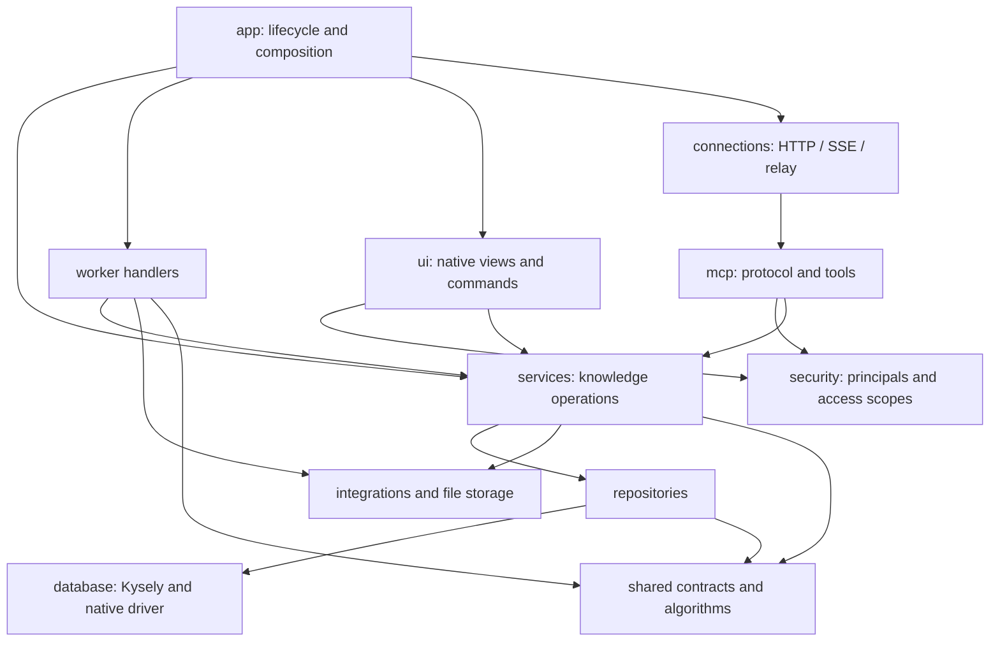

# Knowledge Plugin Source Architecture and Migrations

Implementation status reviewed: 2026-11-11 for preview 0.2.0-preview.1. The target tree below describes the plugin's module boundaries and broader design; it is not a literal current file inventory. Plugin lifecycle, reader/search/block editing, sixteen database migrations, knowledge metadata/membership, durable PaddleOCR/MinerU parsing/publication, native settings, collection synchronization, vector ingestion, USearch, retrieval/reranking and the 16-tool local MCP endpoint are implemented. Complete backup/restore, broader source/editing parity and remote HTTPS/relay adapters remain pending. See [current delivery status](project-status.md), [reader](markdown-reader.md), [MCP](mcp.md), [retrieval](vector-retrieval.md) and [database runtime](database-runtime.md).

Scope: local knowledge libraries/resources, structured content, ingestion, parsing, embeddings, retrieval, shared code, persistence, Zotero plugin UI, MCP tools/authorization and connection adapters. A standalone Web frontend and unrelated agent/project/workflow services are outside this plugin's scope. Plugin-native UI is part of this design. Existing account/relay integration remains a separate adapter boundary, subject to its pending external contracts.

Processing configuration: processing uploads native Zotero PDFs through PaddleOCR multipart jobs (default PaddleOCR-VL-1.6) or MinerU v4 signed binary upload and batch polling. Native Zotero Settings selects one parser with independent API/key/options and fixed models, plus separate shared queue limits, backed by the hot-reloaded private JSON file. Import Tasks combines durable parse history, embedding/index stages and explicit continuous collection bindings; runtime samples/reset controls are absent. Bailian vector ingestion and reranking run through extensible independent provider interfaces. Direct-result import remains deferred. See [collection sync ownership](collection-sync.md). The complete tree below is still a broader target architecture, not an assertion that every named module exists.

Kysely's JavaScript/TypeScript `Migrator` owns migration ordering and execution. Keep a pure Zotero plugin at runtime. Follow the [database design](database-design.md), [runtime assessment](migration-assessment.md) and all five accepted steps in the [migration plan](migration-plan.md).

## 1. Plugin Module Responsibilities

| Plugin boundary | Responsibility |
| --- | --- |
| `src/database/` | Independent SQLite connection, typed queries, transactions, migrations and upgrade snapshots |
| `src/repositories/` | Bound persistence operations and scoped reads inside shared transactions |
| `src/shared/contracts/`, `src/schemas/` | Content identities, typed records and runtime validation |
| `src/services/` | Literature admission, content publication/editing, processing, retrieval and MCP application rules |
| `src/worker/`, `src/parsers/` | Durable execution, provider adapters, artifact normalization and local vector indexing |
| `src/storage/`, `src/integrations/` | Managed local files, native Zotero metadata and protected credential adapters |
| `src/mcp/`, `src/security/`, `src/connections/` | Tool contracts, library-scoped authority, signed continuations and local HTTP/SSE transport |
| `src/ui/`, `src/app/` | Native views and commands, service composition and lifecycle cleanup |

The plugin owns its SQLite schema and migration baseline. Zotero bibliographic records and original attachments remain authoritative and are accessed through native APIs.

## 2. Proposed Source Structure

Organize plugin code into `schemas / services / repositories / worker` layers with explicit ownership. The source initializer creates the module directories with purpose/status READMEs through `npm run init:src`. Add executable modules as their behavior lands; the following complete tree remains a design, not a list of implemented APIs.

The reader uses `app` → `ui/register.ts` → `ui/views/content-reader.ts`, sharing `services/content-read.ts` with attachment-specific published generations through `repositories/processed-content.ts` and the separate legacy/manual cache through `storage/reader-content-store.ts`. Parsing, reader-edit, retrieval and visual/reference contracts are implemented under `shared/contracts/`. `core/disposable-store.ts` owns cleanup; `ui/rendering/` builds safe Markdown/math/citation DOM. `ui/reader-block-session.ts` owns bounded undo/redo, and `repositories/reader-edit.ts` publishes immutable edits, full-text rows, revisions and compatible unchanged vectors transactionally. See [reader usage and limitations](markdown-reader.md).

The native knowledge path is `app/plugin.ts` → `services/knowledge-library.ts` → `repositories/knowledge-library.ts` → the independent plugin database, with metadata projected by `integrations/zotero/knowledge-items.ts`. `repositories/knowledge-trash.ts` retains operation-owned tombstones in dedicated recovery tables and restores locations transactionally. Migration 0006 imports legacy recovery JSON; later operations use relational recovery references. `shared/contracts/knowledge-library.ts` supplies snapshots for the native tree/title/section/menu integration, and `core/method-adapter.ts` isolates reversible native adapters. `app/plugin.ts` also composes parsing, collection synchronization, embedding, retrieval, reader-save and MCP services; `services/startup-recovery.ts` orders deferred recovery stages.

```text
src/
  index.ts                            # Existing bootstrap-facing lifecycle exports
  zotero-globals.d.ts                  # Verified native API declarations
  app/
    plugin.ts                         # Startup/readiness/shutdown ownership
    create-services.ts                # Construct dependencies and register handlers
    window-manager.ts                 # Per-window UI ownership, attachment and disposal
  core/
    config.ts                         # Validated settings and credential references
    errors.ts                         # Stable internal errors, no HTTP envelopes
    logger.ts                         # Redacted logging
    runtime.ts                        # Clock, IDs, hashing and cancellation interfaces
    disposable-store.ts               # Timers/listeners and cleanup
  shared/
    identities.ts                     # Distinct library/resource/source/generation IDs
    enums.ts                          # Lifecycle, availability, review and task states
    contracts/
      knowledge-library.ts            # Shared library/node/membership records
      knowledge-resource.ts           # Resource/source/location/version records
      knowledge-content.ts            # Sections, blocks, generations and evidence
      knowledge-ingestion.ts          # Versioned jobs/checkpoints/outcomes
    validation.ts                     # Reusable shape/text/bounds validation
    content-quality.ts                # Common content classifier/admission rules
    vector-contract.ts                # Immutable vector-space compatibility contract
    text-normalization.ts             # Explicitly versioned normalization rules
    fingerprint.ts                    # Canonical content/configuration hash inputs
  schemas/
    knowledge-library.ts              # Service inputs/results and runtime validators
    knowledge-resource.ts             # Metadata/source/lifecycle mutation contracts
    knowledge-content.ts              # Reads/edits/annotation/reference/history contracts
    knowledge-ingestion.ts            # Import/parse/cancel/retry contracts
    knowledge-search.ts               # Filters, retrieval options and result contracts
  database/
    client.ts                         # Sole connection/query entry point
    types.ts                          # Kysely table mapping and transaction types
    zotero-dialect.ts                 # SQLite compiler/introspection + custom adapter
    zotero-driver.ts                  # Async DBConnection execution and transaction bridge
    unit-of-work.ts                    # Service-owned transaction context
    models/
      knowledge-library.ts            # Private SQL row types and mappers
      knowledge-resource.ts
      knowledge-content.ts
      knowledge-ingestion.ts
    migration-service.ts              # Backup/readiness/checks around Kysely Migrator
    migration-provider.ts             # Static provider: no directory scan/dynamic imports
    migrations/
      0001-local-foundation.ts         # Reviewed initial SQLite schema
      # Later migrations are appended in stable lexical order.
    backup-service.ts                 # Consistent snapshot and explicit restore
  repositories/
    knowledge-library.ts              # Libraries, tree and membership provenance
    knowledge-resource.ts             # Resources, sources, identifiers and native links
    knowledge-content.ts              # Generation/section/block queries
    knowledge-ingestion.ts            # Jobs/runs/checkpoints and conditional lease writes
    knowledge-search.ts               # Metadata/FTS/vector candidate access
    knowledge-history.ts              # Revisions, receipts, annotations and references
    outbox.ts                         # Transactional events and consumer checkpoints
  services/
    knowledge-library.ts              # Library/folder lifecycle and default rules
    knowledge-resource.ts             # Metadata and resource lifecycle
    resource-source.ts                # Multiple sources and canonical-source selection
    resource-membership.ts            # Library/node membership and origins
    content-read.ts                    # Bounded document/section/block reads
    content-change.ts                  # Change sets, ordering, merge/split and review
    content-publication.ts             # Atomic generation switch and index invalidation
    resource-annotation.ts             # Versioned annotation operations
    resource-reference.ts              # Versioned reference operations
    resource-revision.ts               # History and operation-receipt behavior
    ingestion.ts                       # File/text/native import orchestration
    parse-job.ts                       # Create/inspect/cancel/retry parse jobs
    knowledge-search.ts               # Channel fusion, evidence and explicit degradation
    embedding-profile.ts               # Immutable profiles and active selection
  worker/
    runtime/
      scheduler.ts                    # Bounded slots, wakeups and handler registration
      task-queue.ts                   # Common durable queue facade
      lease.ts                        # Claim/heartbeat/execution fencing
      retry-policy.ts                 # Due times, failure budgets and provider deferral
      reconciliation.ts               # Expired leases and missing-work recovery
    zotero-import-worker/
      runner.ts                       # Native scanning/change reconciliation
      contracts.ts
      preparation.ts                  # Selection, metadata and attachment snapshots
      merge.ts                        # Source/membership mapping decisions
      importer.ts                     # Transactional native mapping publication
    parse-worker/
      runner.ts                       # Durable validate/submit/poll/download checkpoints
      contracts.ts
      provider.ts                     # Internal parsing-provider contract
      paddleocr.ts                    # Project-service adapter; final API still pending
      custom-service.ts               # Compatible configured URL/token adapter
      transform.ts                    # Pure result validation and normalization
      artifacts.ts                    # Staging, local image references and manifests
      importer.ts                     # Direct-result import and shared publication path
    vector-worker/
      runner.ts                       # Profile-bound API batches and fenced persistence
      contracts.ts
      tasks.ts                        # Snapshots, input hashes and deduplication keys
      rebuild.ts                      # Durable profile-scoped rebuild
  integrations/
    zotero/
      item-reader.ts                  # In-process item/collection reads
      attachment-reader.ts            # Native file availability/permission handling
      notifier.ts                     # Register/coalesce/dispose native notifications
    model-client.ts                   # Embedding and reranking APIs
    http-client.ts                    # Bounded requests, timeout and cancellation
    credentials.ts                    # Verified protected credential-store adapter
    vector-index.ts                   # Gecko-compatible local engine boundary
  storage/
    file-store.ts                     # Managed root, safe paths and staging
    artifact-store.ts                 # Parser artifacts and file references
    recovery.ts                       # Interrupted publication and safe cleanup
  ui/
    register.ts                       # Native entry points; verify actual registration APIs
    commands.ts                       # Validated actions mapped to application services
    view-models/                      # Per-window state, pagination and pending actions
    views/
      knowledge-library.ts            # Library/folder tree and resource list
      resource-detail.ts              # Sources, parsing/index state and provenance
      content-reader.ts               # Section navigation, blocks, citations and edits
      search.ts                       # Search modes, evidence and source navigation
      processing.ts                   # Queue progress, retry/cancel and partial outcomes
      settings.ts                     # Native scopes, parser/model profiles and credentials
      mcp-access.ts                   # Endpoint status, token/library/scope management
    components/                       # Reusable tree/list/progress/empty/error controls
    rendering/
      markdown.ts                     # Sanitized content and managed-image references
      source-navigation.ts            # Validated native attachment/page navigation
    events.ts                         # Committed-state invalidation subscriptions
  security/
    principal.ts                      # Explicit local-owner and token/grant identities
    authorization-service.ts          # Current scopes and allowed libraries/resources
    token-service.ts                  # Local token issuance/hash/expiry/revocation
    cursor-service.ts                 # Signed scope/filter/version-bound continuation
  mcp/
    server.ts                         # Protocol state/capabilities and request lifecycle
    protocol.ts                       # Initialization, JSON-RPC and negotiated semantics
    request-context.ts                # Principal, request identity and cancellation
    dispatcher.ts                    # Validate, authorize and invoke registered tools
    tool-registry.ts                  # The 16 named tools and their discovery schemas
    contracts.ts                      # Wire schemas, projections and structured results
    presentation.ts                   # Consistent compact/standard/full serialization
    errors.ts                         # Application errors -> MCP/JSON-RPC mapping
    tools/
      discovery.ts                    # Library/folder/resource/block-type listings
      reading.ts                      # Resource/node/block/reference/annotation/history reads
      search.ts                       # search_content with grouped source evidence
      mutations.ts                    # add_annotation and update_summary
  connections/
    transport.ts                      # Native-independent request/response/stream boundary
    http-listener.ts                  # Plugin-owned loopback HTTP listener and limits
    streamable-http.ts                # JSON requests, SSE responses, headers and disconnect handling
    legacy-sse.ts                     # Optional separately tested legacy transport
    tls-listener.ts                   # Direct HTTPS, conditional on native TLS prototype
    account-client.ts                 # Existing account/device registration adapter
    relay-client.ts                   # Existing relay/tunnel adapter and reconnection
```

`database/` owns SQLite access and migration integration; `storage/` owns files. TypeScript row models describe the local database. Use Kysely as a typed query/execution facility where useful, while retaining reviewed SQL for triggers and special SQLite constructs.

## 3. Dependencies and Shared Code



- `shared/` stays pure: no native globals, SQL, IO or Node modules. `schemas/` adds validated operation contracts without importing services/repositories. Separate database rows, shared records and service commands with explicit mapping.
- Services own transactions; repositories accept the same transaction context. Publishing content, switching the active generation, recording receipts/revisions and enqueueing durable events commit together. Avoid private engines, unrelated nested transactions and unrestricted generic CRUD helpers.
- Worker handlers use services/repositories with an execution context. Services enqueue through an injected queue/outbox interface and never import worker runners. `app/` constructs and registers concrete handlers, avoiding circular dependencies.
- Upload/poll/download/embedding/reranking occur outside write transactions. Immediately before commit, recheck source/content/profile versions, cancellation and the current unexpired execution token.
- Every protected query takes explicit allowed-library/resource scope before candidate selection, counts and reads. Native write permissions remain authoritative. Local operation must not require server user/project records.
- UI commands and MCP tools call the same validated application services with explicit principal/scope contexts. Neither layer accesses repositories/SQL or duplicates publication, revision, task or permission rules. Local UI is a local-owner context, not an implicitly all-powerful remote token.
- Services do not import UI, MCP or transport code. Per-window state, request/session state and durable processing state have separate owners. Disposing a view must not stop the plugin's shared queue or invalidate another client's request.

| Shared concern | Owner | Rule |
| --- | --- | --- |
| IDs, enums and content/source contracts | `shared/` | Distinguish individual attachments/generations and preserve absent coordinates |
| Quality classification, normalization and vector profiles | `shared/` | Same algorithms for parsing, snapshot creation and retrieval; equal dimensions do not prove compatibility |
| Errors, clock, IDs, logs and cleanup | `core/` | Stable failures, redaction, deterministic tests and complete unload cleanup |
| Runtime input validation | `schemas/` and shared primitives | TypeScript types alone do not validate imported JSON |
| Connection, transactions, migrations and backup | `database/` | One independent plugin database and controlled transaction ownership |
| File staging/publication | `storage/` | Files and SQLite are not one atomic transaction; keep recoverable manifests |
| Leases, retry/cancellation and reconciliation | `worker/runtime/` | At-least-once handling, stale-result rejection and durable progress |
| HTTP/model/credential access | `integrations/` | No secrets in jobs/logs; retry only operations whose semantics permit it |
| Scope authorization and signed continuation | `security/` | Shared service enforcement for UI/MCP; cursors bind current authorization and content state |
| Rendering, selection and interaction state | `ui/` | Per-window state; application rules remain in services |

Keep local services focused while preserving atomic business operations. Consolidate repeated lease errors, hash inputs and normalization rules when their semantics match. Avoid catch-all `utils.ts` or duplicated task queues.

## 4. Processing Semantics Retained

1. **Native ingestion:** stable resource/source identities, metadata fingerprints, attachment availability and membership provenance. Notifications schedule work; restart/full-scan reconciliation recovers gaps. Replace remote OAuth/WebDAV acquisition with native APIs.
2. **Parsing:** durable submission state, remote job identity, stages/checkpoints and warnings. Implemented PaddleOCR and MinerU adapters own their documented upload/poll/result contracts, with compatible configured endpoints. Both converge on shared structured publication. Direct-result import remains a deferred adapter and has no final accepted format.
3. **Partial results:** retain original page numbers/gaps; never infer ambiguous missing-page positions. Distinguish partial content, missing source, provider failure and indexing failure.
4. **Reparse/edit protection:** keep the last readable generation until replacement succeeds; reject stale imports. Preserve human edits and annotations through explicit generation targets/rebinding rules, using the reviewed local immutable-generation model.
5. **Embeddings:** snapshot ordered block IDs, effective input hashes, admission-rule version and immutable profile configuration. Reuse compatible unchanged vectors; reject stale results and bound batches/concurrency. Rebuilds are durable/profile-scoped, not automatically destructive global resets.
6. **Retrieval:** metadata/full-text/vector channels, fusion, query-dependent reranking, source evidence and explicit degradation. Verify local tokenization and engine performance; do not load every resource ID/vector into memory to implement scope filtering.

## 5. Migration Manager: Kysely Migrator

Select [Kysely](https://kysely.dev/) `Migrator` with a static `MigrationProvider` and a custom Zotero SQLite dialect/driver. The plugin needs no Python migration runtime. Kysely manages migration order/history/execution, while the plugin owns backup, capability validation and native database adaptation.

### Compatibility Evidence and Remaining Work

The project pins `kysely@0.29.7`. Its migration/query code bundles for browser/Firefox 140 and runs without Node globals. The native driver, named bindings, JSON/STRICT/FTS, transactional DDL, initial creation, repeat initialization, upgrade snapshots, failed migration rollback and plugin reload have also been verified in isolated Zotero 10.0.6, SQLite 3.49.2. A separate Node process was excluded by the live native database's SQLite lock. See the [runtime report](database-runtime.md) for evidence and remaining limits.

- Do not use `FileMigrationProvider` or rely on filesystem scanning/importing installed migration files. Return explicitly imported migration modules from a static provider so Scaffold bundles them with the plugin.
- The stock `SqliteDialect` uses a synchronous SQLite database interface. Implement an asynchronous `Driver`/`DatabaseConnection` bridge to the verified independent `Zotero.DBConnection`, mapping rows, changed-row counts, BLOBs, bound parameters and transaction lifecycle accurately. Reuse compatible SQLite compiler/introspection pieces instead of assuming the stock driver works.
- The inspected `SqliteAdapter` reports `supportsTransactionalDdl = false` and its migration-lock methods are no-ops. Do not inherit these defaults and claim atomic upgrades or cross-process locking. Prove native transactional DDL and locking first, then supply an adapter/driver with the verified behavior. Unsupported operations or runtime behavior must fail the foundation gate.
- Kysely Migrator returns an error in its result object; initialization must explicitly inspect it and refuse readiness on failure. Do not treat a resolved promise as migration success.

The native dialect uses `BEGIN IMMEDIATE` and transactional DDL. The main connection uses NORMAL locking with WAL for external read-only inspection; a separate `knowledge.sqlite.owner.sqlite` connection holds the exclusive owner lock. A process-lived host registry additionally excludes duplicate plugin bundles within Gecko's shared cache. The Kysely lock row is diagnostic, not the exclusion primitive. The adapter uses named bindings to avoid Gecko's first-BLOB positional-binding ambiguity, bypasses Zotero's NULL-rewriting parameter parser and receives CTE/RETURNING rows through the native row callback. Repositories must map named getters explicitly into ordinary records.

### Migration Files and Version Tables

Each `src/database/migrations/<ordered-name>.ts` exports `up(db)` and, only where safely supported, `down(db)`. Use stable zero-padded names such as `0001-local-foundation`; append later migrations after release. Historical files must not import mutable current repositories/services/models or invoke provider APIs.

The provider supplies a static map to Kysely. Keep unordered migrations disabled, require applied names to form the supported prefix and retain historical migrations in every release. Unknown/missing/newer history blocks normal database access; plugin package version is not the schema version. Migrations use a linear ordered history without automatic model-diff generation.

Use Kysely's own metadata tables, whose inspected default shapes are:

| Table | Fields | Ownership |
| --- | --- | --- |
| `kysely_migration` | `name` primary key, `timestamp` ISO string | Kysely records successfully applied migrations |
| `kysely_migration_lock` | `id` primary key, `is_locked` integer | Kysely infrastructure; actual exclusion depends on the custom adapter |

These manager-owned tables use its expected SQL shape; application tables retain the reviewed `STRICT`/UTC-millisecond conventions. The design fixtures reserve empty tables for inspection only. Actual installation lets Kysely create/manage them; do not create them again inside migration 0001. Do not maintain a second migration ledger.

Kysely's history does not include source checksums. Build-time checks verify immutable history and packaged migrations. The plugin records installed checksums in versioned `plugin_state` entries within the migration transaction; this supplemental integrity metadata is separate from the migration ledger. Do not claim checksums are a built-in Kysely feature.

The SQL fixtures are promoted into sixteen static migrations with exact schema comparison and generated type/checksum checks. The current 56 typed tables include Kysely metadata, FTS5, processing/vector storage, Trash, reference/visual projections and MCP revisions. Shared bounded batches keep predicates/inserts on the caller's transaction; persisted Trash scopes use relational queries. The 0006 importer retains its explicitly accepted compatible checksums for identical-schema databases without rewriting history. FTS and MCP service behavior is implemented. A nonempty unversioned database is rejected rather than adopted or stamped.

### Initialization and Recovery

1. Keep normal services/observers/workers inactive. Validate the plugin-owned path and acquire the separate exclusive owner lease before any main-database preflight, capability checks, history inspection, backup or bootstrap.
2. Under that ownership, validate capabilities/history and reject unsupported or unversioned states. Create a verified WAL-aware backup for an existing database with pending upgrades. A copied live main file or an in-memory promise alone does not provide consistent backup or cross-process exclusion.
3. Run Kysely with the verified transaction/locking adapter. For the initial transactional migration set, use one migration-run transaction for all pending migrations and history updates, matching the inspected Migrator behavior. Avoid a handwritten second execution loop or nested transaction ownership. On any error roll back the pending set; do not mark failed migrations applied.
4. Verify migration results, exact history and integrity before readiness. Then recover jobs/staged files, reconcile native mappings and start normal services. Failed startup cleans up partially acquired resources and closes storage.

Migration preflight/bootstrap table creation can have separate manager-owned behavior; test interruption there as well. Do not split trigger SQL with `split(";")`. Support reviewed transactional DDL/data changes initially. Table reconstruction, special pragmas or nontransactional operations need an explicit tested execution plan; large derived-index rebuilds belong in restartable jobs.

`down()` is a framework capability, not a promise that data conversion can be reversed safely. Prefer forward repair and validated backups. Restore is explicit, with writers stopped/connections closed, compatible code selected, WAL/SHM handled and referenced files preserved. Never silently recreate/restore a database.

Keep migration history, plugin release, resource/source/content versions, task/checkpoint formats and vector profile/index versions independent. A schema change alone does not require re-parsing PDFs or regenerating unchanged vectors.

## 6. Zotero Plugin UI

The UI is part of the installed Zotero plugin. Local views invoke shared services directly without an HTTP self-client. Use native Zotero entry points and plugin-packaged views/assets; verify actual menu, pane, dialog and settings APIs during implementation before committing to a specific host surface. Keep reusable styles/icons/other runtime assets under `addon/` and bundle application TypeScript from `/src`.

| User workflow | UI responsibility | Service boundary |
| --- | --- | --- |
| Organize knowledge | Library/folder tree, resource list, metadata/source detail and membership actions | Library, resource, source and membership services |
| Process selected items/collections | Select eligible attachments/bindings, choose parser/import path, show scope before enqueueing | Ingestion and parse-job services |
| Monitor and recover | Stage progress, partial results, safe errors, retry/cancel and rebuild status | Job/ingestion/profile services; no direct worker manipulation |
| Read and review | Section tree, bounded block/Markdown reads, available page navigation, annotations/history and reviewed edits | Content-read/change, annotation/reference/revision services |
| Search literature | Search mode/filter controls, grouped evidence, partial-index warnings and source navigation | Knowledge-search and content-read services |
| Configure providers | Project/configured parser and direct import, embedding/rerank profiles, protected credentials and native binding selection | Validated configuration/profile/credential services |
| Configure MCP access | Local endpoint enable/status/diagnostics, selected libraries/scopes, token creation/revocation and connection settings | Connection lifecycle and token/authorization services |

Views render validated view-models and expose loading, empty, unavailable, partial, failure and stale-version states. Paginate/window large lists and load sections incrementally. Debounce search, cancel obsolete view-owned requests and reject late results using request identity and content generation. Preserve unsaved edits and surface a version conflict rather than silently overwriting newer content.

Render extracted Markdown as untrusted content through a reviewed sanitizer. Resolve images through validated managed-file references and native source navigation through known item/attachment identities; never turn arbitrary provider URLs/HTML/path strings into privileged UI execution. Display only available page coordinates.

UI status invalidation comes from committed service/task changes; views re-read authoritative state after notification and on reopen. Do not require a continuously open window for queue progress. Token secrets are shown only at creation; later views show metadata, not reusable plaintext. Remote login does not implicitly grant knowledge-library access.

The implemented `app/plugin.ts`, `ui/register.ts` and `ui/knowledge/register.ts` attach existing/new windows and own their registrations and view requests; `app/window-manager.ts` in the target tree remains a possible extraction. Window unload disposes per-window resources; shared workers/services live until plugin shutdown. Startup failure/hot reload uses the same cleanup. Database initialization failure rejects startup instead of claiming knowledge readiness.

## 7. MCP and Connection Architecture

`connections/` handles bytes, HTTP/SSE framing and native resource cleanup. `mcp/` handles the selected MCP protocol and tool contracts. `security/` resolves identities/current grants; services/repositories enforce constrained reads and mutations. All local/direct/relay connections enter the same authorized tool path.

The following 16 tools and scope assignments are implemented in the local endpoint:

| Scope | Tools | Shared service use |
| --- | --- | --- |
| `knowledge:search` | `list_libraries`, `list_folders`, `list_resources`, `list_block_types`, `search_content` | Library/resource discovery, content statistics and retrieval |
| `knowledge:read` | `get_resources`, `get_resource_content`, `list_resource_nodes`, `get_resource_nodes`, `list_content_blocks`, `get_content_blocks_text`, `list_references`, `list_annotations`, `list_revisions` | Resource/content/reference/annotation/history reads |
| `knowledge:annotate` | `add_annotation` | Versioned annotation mutation |
| `knowledge:update-summary` | `update_summary` | Versioned resource metadata mutation |

Each tool defines validated input/output schemas, defaults/limits, projections, source/generation identities, budgets, truncation/continuation and partial-error behavior. Invalid arguments and unauthorized scopes fail before protected reads or expensive processing. Define and validate per-tool and per-batch constraints instead of assigning one global limit. Writes require `operationId` and `expectedVersion`, with shared transactional receipts and stale-write rejection.

Local tokens have an explicit 1-100 knowledge-library whitelist, search/read defaults, expiry/revocation and optional mutation scopes. Preserve the documented 30/90/180/365-day choices with a 180-day default unless deliberately changed. Store high-entropy token hashes and permission metadata, not plaintext secrets. Any future external authorization adapter is separate from local token issuance; remote login does not establish local access. Use signed expiring cursors bound to tool/filter/principal/authorization revision and content state; revalidate current access even when replaying a mutation receipt.

The local transport negotiates MCP `2025-11-25` and `2025-06-18`, with initialization, discovery/calls, structured output and protocol errors. Local application contract 2.4.0 is separate from the official protocol revision. `connections/mcp-http.ts` implements native Gecko transport without a Node server SDK or helper process.

The plugin-owned loopback listener uses SSE-only Streamable HTTP at `http://127.0.0.1:23126/mcp/knowledge` by default, with a configurable port and explicit Host/Origin/token/request-size/concurrency controls. JSON response mode, persistent protocol sessions, event replay and legacy HTTP+SSE are not implemented. Listener-lived signed client identities isolate cancellation/request IDs for shared-token clients. See [the transport contract](mcp.md) for notification, disconnect and cleanup behavior.

Direct public-IP HTTPS and account-based outbound relay access remain deferred adapters, conditional on native TLS and existing-service contract verification. They must preserve streaming semantics and the same scoped authorization. Local data processing needs no login. Future content synchronization is separate; Zotero must be running for access to local data.

## 8. Implementation and Verification

The delivery map separates responsibilities: Step 2 covers necessary core/shared contracts, Kysely/native storage, first repositories and worker-runtime primitives, with minimal diagnostics/settings UI. Step 3 covers ingestion/parsing/import/publication/embeddings alongside source selection and task-progress UI. Step 4 covers reading/review/search services and their native views. Step 5 covers MCP/security/transports and the access/connection settings UI over those existing services. UI is delivered with each usable capability rather than omitted or deferred wholesale.

Required implementation checks: new initialization and every supported upgrade path; repeated startup with no pending work; missing/out-of-order/newer history; manager result errors; source/package integrity; DDL/history rollback; lock contention; interrupted bootstrap/upgrade; WAL-aware backup/restore; triggers and BLOB/serialization; stale workers and profile mismatches. Run `npm run typecheck` and `npm test` for code/schema changes, and separately verify the actual driver, transactions, migration locking and reload behavior in an isolated Zotero profile.

UI checks cover existing/new windows, repeated reload/disposal, duplicate registration, failed readiness, large lists, stale async results, unsaved edits, sanitization and native source navigation. Verify rendered behavior manually in real Zotero, separately from VM simulations. MCP checks cover initialization/discovery/calls over the implemented SSE transport, schema/budget/cursor behavior, unauthorized batches/counts/references, token expiry/revocation, idempotent writes, cancellation/disconnect/slow readers and listener cleanup. Confirm real client interoperability separately from mocked protocol tests.

The initialized layout, reader, database/migrations and native metadata/membership paths are implemented. `services/parsing.ts` and `parsing-config.ts` own admission, projections and configuration reload; `repositories/processing.ts` owns claims/checkpoints and atomic publication. `worker/parse-worker/` owns scheduling/artifact staging; peer `parsers/paddleocr/` and `parsers/mineru/` implementations converge through the parser registry. `storage/parse-files.ts` recovers staged files, and `repositories/processed-content.ts` supplies generation-backed reading. `services/collection-sync.ts` and its repository own native collection bindings; `services/import-tasks.ts` combines parse/embedding/sync history. `services/embedding.ts`, `repositories/embeddings.ts`, `services/vector-store.ts` and `worker/vector-worker/` own canonical vectors and replaceable USearch snapshots. `services/retrieval.ts` supports plugin and reader search. `repositories/reader-edit.ts` implements transactional saves. `services/mcp.ts`, `mcp/tools/`, `security/` and `connections/mcp-http.ts` implement the scoped local endpoint; `ui/mcp-settings.ts` owns token administration. The application owns shared services; task views own subscriptions only. Complete backup/restore, broader source/edit/review parity, remote permission views and HTTPS/relay connections remain open. Metadata/schema and synthetic-provider checks do not establish representative OCR accuracy or independent search quality.
