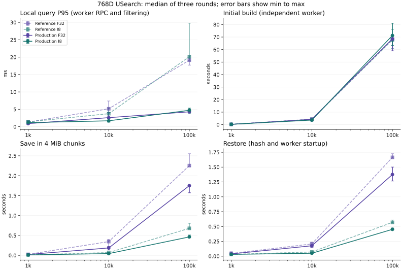
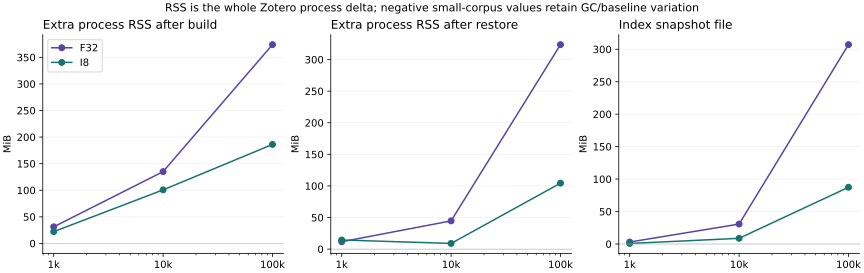

# Vector ingestion, retrieval and reranking acceptance

Measured on 2026-10-24–25 on Windows, Zotero 10.0.6 / Gecko 140.17.0; Node.js 22.23.1 controls builds and automation. Hardware: AMD Ryzen 9 5900X, 12 cores / 24 threads, approximately 32 GiB RAM.

The measured provider/index results below retain that date and fixture scope. See [vector retrieval](vector-retrieval.md) for current behavior and [inline rendering](retrieval-toggle-performance.md) for its separate measurements.

## Delivery and verification boundaries

Implemented: embedding ingestion/recoverable tasks, persistent USearch, full-text/semantic/enhanced/fusion retrieval, Bailian reranking, native search/evidence/settings and seven locales. Local authenticated MCP is also implemented; its later protocol verification is documented in [local MCP access](mcp.md). Runtime work remains inside Zotero; Node controls development, and Python supports compilation/report generation, without a retrieval helper process.

The later [2026-11-09 recovery correction](mcp-vector-initialization-audit.md#recovery-guarantees)
verifies the populated application-owned index with real MCP vector/hybrid queries,
main-window closure and local failure/retry. Earlier acceptance measurements below
retain their original runtime, provider and fixture boundaries.

Default: 768D Float32; supported dimensions 512/768/1024/2048; lightweight mode uses Int8. Both modes use USearch, normalized cosine, JS-source restore callbacks and a 32 MiB vector-arena cap with upstream graph allocation. Canonical normalized Float32 BLOBs remain authoritative; only the index is quantized. Space changes offer keep/clear/cancel. Precision changes rebuild locally.

| Area | Implemented behavior and boundary |
| --- | --- |
| Providers | Separate embedding/rerank adapters; Bailian production adapter and a distinct synthetic protocol verify extensibility without orchestration/form changes |
| Credentials | Gecko Login Manager; configuration/database store references; logs exclude keys/full request bodies |
| Ingestion | Publication/startup reconciliation, ready/partial generations, admission/splitting, transactional batches, input hashes and stale/cancel fences |
| Tasks | Backfill/manual embedding, retry, pause/resume/cancel, index stage and counts; cancellation persists |
| Snapshots | Reused 4 MiB output chunks, incremental hash, atomic temporary-file publication, database activation and cleanup journal; corruption rebuilds from BLOBs |
| Scope/ranking | Native library/collection, knowledge library/folder and tags constrain candidates; at most 5000 allowed vectors use exact search; document deduplication/evidence aggregation |
| Fusion/failure | Document RRF, k=60, then rerank; rerank failure preserves order; fusion vector failure retains text/metadata; pure semantic failure is explicit |
| Native entry | Original modes retained; knowledge full text in dropdown; three mutually exclusive buttons; Enter submission, IME/stale-request protection, independent preference |
| Evidence | Source attachment, section/page, score provenance, processing/coverage state; unavailable positions are explicit |
| Localization | Complete English, Simplified/Traditional Chinese, German, French, Spanish and Japanese catalogs |

Native API/DOM checks are developer-driven and distinct from Node simulations and manual interaction. Seven-locale DOM checks do not establish seven-language manual acceptance.

## Search, settings and tasks

Settings show saved/missing/pending/shared key states without redisplaying plaintext. Connection tests show progress, cancel, time out after fifteen seconds without retries, do not save, and fence responses after edits/close. Normal retrieval retains retries. Maintenance distinguishes provider-backed vectorization from local index repair.

Import Tasks groups parsing, embedding and local index stages by source attachment and published generation. Vector retries do not reparse; batch actions dispatch by stage. Parser and model providers remain separate.

The knowledge overview searches the union of active knowledge libraries. Knowledge Trash has recovery-owned scope and remains excluded from ordinary search; retained content/vectors under deleted libraries can be searched there and leave that scope after restore. Native Trash includes only admitted knowledge items. Retrieval returns documents; ordinary Trash still displays container recovery rows.

## Result presentation

The retained scoring contract uses cosine for semantic search and rerank scores after successful reranking. Keywords are direct matches. If fusion rerank fails, vector-backed documents use their best cosine; keyword-only documents remain direct matches. BM25/RRF are not numerically compared to 0.5 or presented as probabilities. Both groups together obey the final result limit; changing the threshold does not regenerate vectors.

Current results use real native Zotero item rows, one possible-relevance separator and a 224-pixel inline evidence area. `node scripts/verify-vector-result-ui.mjs` checks these contracts using isolated content without provider calls.

## Real content and Bailian integration

The five-paper fixture retained source/version mappings. Ingestion imported 1,513 raw blocks and persisted 1,075 vectors after skipping 438: 326 references, 60 pure equations and 52 repeated template/page-edge blocks. Raw blocks remain available for full text/evidence.

The first run actually embedded/stored documents. The query repeat reused real persisted vectors but made fresh Bailian query-embedding/rerank requests, without cached or simulated replacements for network acceptance. Sixty queries covered synonyms, English/Chinese and cross-topic ambiguity; full-text/fusion checks were additional.

| Measurement | n | P50 ms | P95 ms | Mean ms |
| --- | --- | --- | --- | --- |
| Query embedding HTTP | 61 | 174 | 442 | 222.26 |
| Rerank HTTP | 61 | 137 | 192 | 147.61 |
| Semantic local service, including SQL/scope/document aggregation/evidence | 60 | 178 | 258 | 194.17 |

HTTP timing spans request dispatch to response completion, excluding provider queue/rate/retry waits. There were 122 new requests; an extra fusion request followed a pause long enough to expire query cache. Local service and index RPC timing below have different boundaries. The later [HTTP reuse investigation](model-http-reuse.md) confirmed shared HTTP/2/no repeated handshakes after the first request. It is a separate short-input batch and must not be merged with these measurements or interpreted as a networking implementation change.

Semantic and enhanced top-ranked documents matched query-design seeds in 56/60 cases; every returned document carried evidence, without degradation. Seeds were developer-selected target papers, not independent passage-level human relevance labels. Thus 56/60 is not human semantic accuracy. No independent label set or hard recall/performance budget was established.

## Index performance protocol

Wikipedia-Cohere normalized 768D cosine vectors were tested at 1000/10000/100000. Scalars/paths shared vectors, allowed labels and the first 500 fixed queries, with exact Float32 cosine answers as reference. Top100 queries warmed up thirty times. This measures index recall/performance, not local-paper semantic quality.

Each group used an independent worker and three rounds alternating scalar/path order. Tables contain medians of round metrics; SD is each round's population SD over 500 queries, then its three-round median. Figure error bars show round minima/maxima. Raw per-query/per-round values remain in JSON and ranges in CSV. QPS = 1000/mean milliseconds, an inverse sequential latency, not concurrent stress-test throughput.

Build includes worker/WASM initialization, batched vector reads/insertion. Restore includes a new worker, file reading, hash and deserialization, not graph construction. OS file caches were not cleared: this is new-worker restore cost, not fully cold physical disk. Query timing includes worker RPC, scope cache and index execution, excluding providers, SQL and UI. At 1000 labels search is filtered exact; larger conditions use filtered ANN. Int8 retains quantization error even under exhaustive scanning.

Main-process RSS was sampled every 25 ms. Extra built RSS subtracts pre-run RSS; extra restored RSS subtracts RSS after worker close/idle, with forced GC and a one-second wait. Peaks are absolute process RSS, not index-exclusive memory; backgrounds vary. WASM heap is linear capacity including reserved/allocator memory. Small negative RSS deltas are retained rather than clipped.

| Size | Mode | Rounds | Build s | Query P50 / P95 / P99 ms | Mean / SD ms | QPS | R@20 / R@100 | Save / restore s |
| --- | --- | --- | --- | --- | --- | --- | --- | --- |
| 1000 | Float32 | 3/3 | 0.24 | 0.660 / 0.887 / 1.091 | 0.688 / 0.226 | 1453.3 | 100.00% / 100.00% | 0.023 / 0.039 |
| 10000 | Float32 | 3/3 | 4.22 | 1.464 / 2.600 / 5.506 | 1.627 / 1.011 | 614.5 | 99.32% / 98.20% | 0.186 / 0.176 |
| 100000 | Float32 | 3/3 | 68.54 | 3.429 / 4.278 / 4.832 | 3.446 / 0.638 | 290.2 | 98.21% / 94.81% | 1.750 / 1.375 |
| 1000 | Int8 | 3/3 | 0.26 | 0.761 / 1.169 / 1.376 | 0.825 / 0.329 | 1212.6 | 89.30% / 93.08% | 0.011 / 0.031 |
| 10000 | Int8 | 3/3 | 3.63 | 1.110 / 1.692 / 2.037 | 1.216 / 0.545 | 822.1 | 87.55% / 88.81% | 0.044 / 0.050 |
| 100000 | Int8 | 3/3 | 71.23 | 3.353 / 4.718 / 5.746 | 3.439 / 0.816 | 290.8 | 86.08% / 86.36% | 0.463 / 0.453 |

The figures compare production with an internal control of the same plugin
engine. The control disables transfer reuse, restore-source release and scope
caching; its chunk protocol has an additional round trip. This is a bounded
configuration comparison, not an independent engine benchmark.



| Size | Mode | Extra built RSS MiB | Build peak RSS MiB | Save peak RSS MiB | Extra restored RSS MiB | Saved WASM heap MiB | Snapshot MiB |
| --- | --- | --- | --- | --- | --- | --- | --- |
| 1000 | Float32 | 31.24 | 522.38 | 538.82 | 11.75 | 23.12 | 3.07 |
| 10000 | Float32 | 135.09 | 639.40 | 656.62 | 44.76 | 77.88 | 30.71 |
| 100000 | Float32 | 373.92 | 932.31 | 897.32 | 323.61 | 349.62 | 307.13 |
| 1000 | Int8 | 22.20 | 524.42 | 531.09 | 14.48 | 19.25 | 0.87 |
| 10000 | Int8 | 100.76 | 603.06 | 585.22 | 9.05 | 23.12 | 8.74 |
| 100000 | Int8 | 186.23 | 753.15 | 699.36 | 104.43 | 142.44 | 87.40 |



Snapshot sizes describe one active logical file, excluding canonical Float32, text, SQLite/WAL and retired snapshots. Both modes retain approximately 292.97 MiB of raw payload at 100000×768×4. Int8 saves index-copy space. Saving may retain an old snapshot and temporary replacement together, so one-file size is not peak disk usage.

Parameters: M=16, efConstruction=100, efSearch=200, arena32. These measurements
do not include a complete parameter sweep or large-scale 2048D acceptance.

## Snapshot recovery checks

Ten complete query rankings per restore matched pre-save rankings. Node also checks chunk output against official full serialization for both scalars. Recovery tests terminated a worker during a save, then used the last published snapshot. There were no OS force-kill, power-loss or storage-hardware fault experiments; normal process shutdown/restart was performed.

## Usage and unmeasured areas

Both modes produced approximately 290 sequential QPS at 100000 vectors; Int8 is not inherently the faster mode. Default Float32 offers stronger candidate recall: R@100 94.81% versus Int8 86.36%; reranking cannot recover omitted candidates. Memory-constrained users may select Int8: extra restored RSS 104.43 versus 323.61 MiB in this condition, with the same canonical data. Initial graph construction takes approximately a minute; reuse snapshots, and rebuild corrupted indexes locally without paying to regenerate embeddings. Both modes share workers, scope/task/evidence behavior; Int8 saved/restored faster in these samples.

Still unverified: independent human relevance labels, manual review of every locale screen, long-term operation on different hardware, OS-level crash behavior and large-scale 2048D performance. IME, full scope combinations, drag/drop and all degradation combinations primarily have automated coverage; native DOM checks do not replace every manual combination. Missing measurements are not zero or completed work. Agree hard performance/recall budgets separately.

## Reproduction

See [implementation/configuration](vector-retrieval.md). Set `ZOTERO_DEBUG_PORT` for the isolated instance; controllers reject data directories outside `.scaffold`. Wait for each report's terminal `status` before the next lifecycle-changing action.

```powershell
npm run typecheck
npm test
npm run database:check
node scripts/verify-vector-xpi.mjs --replace-active
node scripts/verify-vector-native.mjs
node scripts/verify-vector-ui.mjs
node scripts/verify-vector-search-ui.mjs
node scripts/verify-vector-recovery.mjs '<completed-run-id>'
node scripts/verify-vector-live.mjs
node scripts/verify-vector-performance.mjs --compare
python scripts/report-vector-acceptance.py '<generated-performance-report.json>'
```

Live checks consume Bailian quota and are unnecessary for routine regression. `verify-vector-live.mjs <completed-run-id>` reuses persisted document vectors and calls query embedding/rerank again; fresh runs require prepared isolated parse snapshots and provider settings. UI checks depend on known isolated items. Recovery modifies a new copied database only. Performance requires prepared `wikipedia-cohere-768/cosine` data/exact answers. XPI: `.scaffold/build/zotero-knowledge-mcp.xpi`. Raw JSON/SQLite/CSV, queries and model outputs remain ignored.
